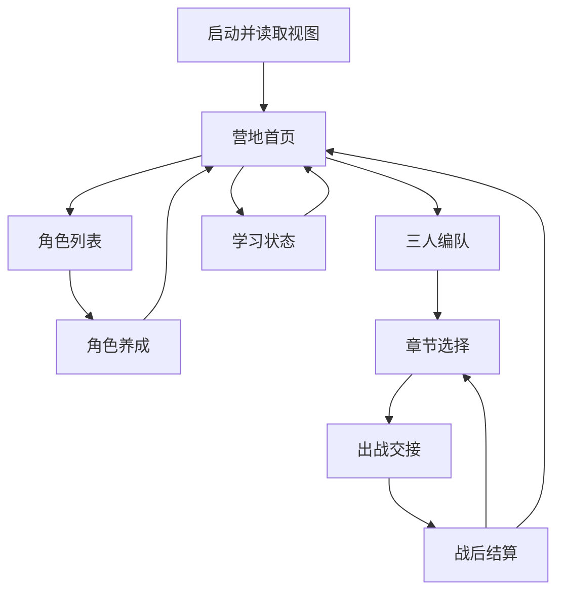
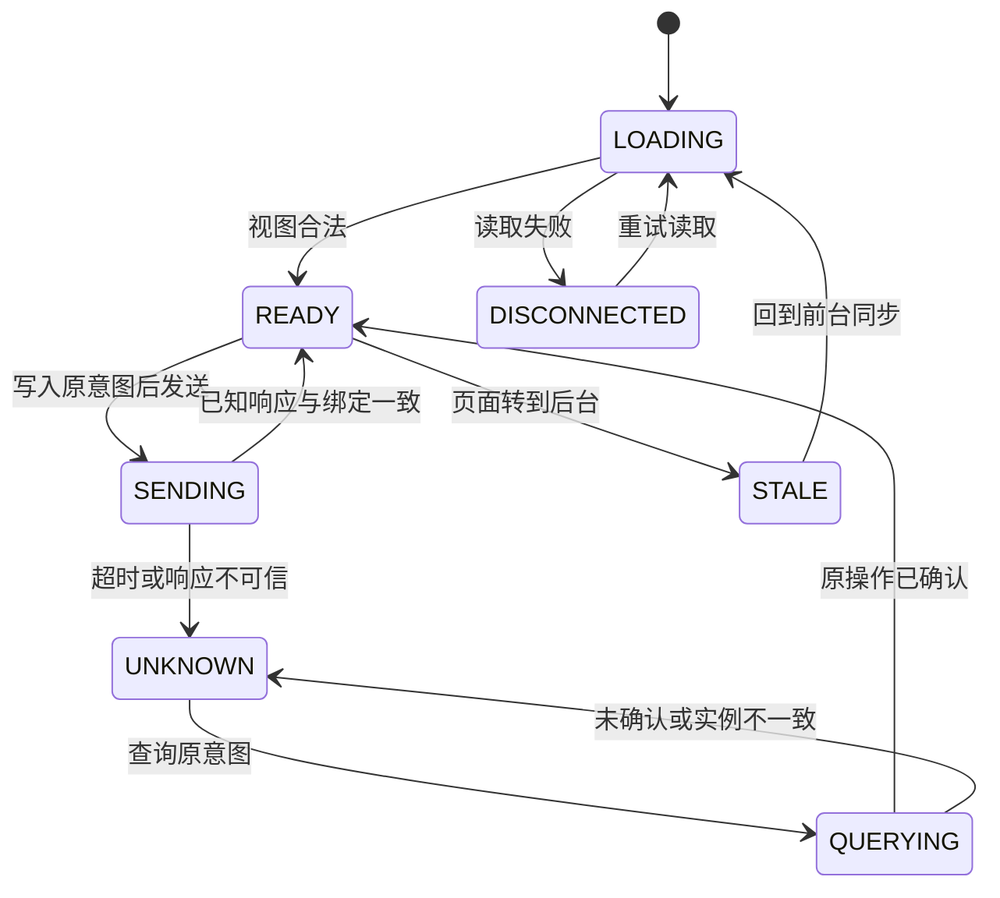

# P20 页面、编队与恢复流程

版本 `P20-METAUI/0.1.0-isolated`；任务 `P20-S05-S06-S07-METAUI-001`。本图和交互是 P20 已实现的隔离组件，P23 正式用户流程尚未收到。本轮没有另建岗位或开启扩展玩法。

## 页面路径

所有页面均可从导航访问；没有数据时使用明确的空态。菜单导航本身没有领域副作用。`handoff` 仅显示已保留的出战引用；本包没有战斗界面、胜负计算或动画。实际测试中的结果由独立 `/lab` 测试入口注入，再经过原 P18 校验。

| 页面 | 只读内容 | 用户请求 | 空态或阻塞 |
| --- | --- | --- | --- |
| home | 已提交编队、钱包、学习连接 | 页面导航、同步 | 无接口显示 `—` 与占位提示 |
| characters | P04 测试显示名、P17 等级/属性 | 查看某角色养成 | 无角色时不创建角色 |
| party | P17 三席顺序 | `SET_PARTY` | 未满三人、重复、不拥有、存档异常时不可提交 |
| growth | P17 属性、累计 XP、配置费用、装备实例 | `LEVEL_UP` / `SET_EQUIPMENT` | XP/余额不足、上限、装备未批准或实例占用时提示原因 |
| chapters | P18 扩展进度、首通已消耗、review | `ENTER_STAGE` | 锁定、review、活动战斗、非可写存档时不可入场 |
| handoff | 已提交 active battle | 同步、返回菜单/章节 | 返回页面不等于关闭战斗 |
| settlement | 已返回终局及 P18 处理结果 | `CLAIM_STAGE_REWARD` | 无终局、已领取、隔离时不可领取 |
| learning | P11 查询结果与连接/补发状态 | 只读刷新 | 不推算评分收益，不将隔离当到账 |

## 三人编队

编辑使用局部 `partyDraft`，不会修改不可变视图。选择已占用的同伴会交换两席位置；清空一席时保存按钮关闭。保存前同步锁定输入，生成一个请求 ID，并把完整意图持久到浏览器的恢复记录，然后发送。

成功后采用端口返回的新视图，并从 P17 已提交顺序重建草稿。失败时保留既有领域视图和错误原因。仅导航位置、选中角色和选中关卡写入 `p20.navigation.v1`；草稿、钱包、等级、关卡进度、账本都不写到浏览器存储。

浏览器刷新后读取服务器视图恢复已保存编队。未保存草稿会被丢弃。这已通过实际浏览器重载测试；正式 P21 存档恢复仍为 `NOT_RUN`。

## 操作状态机

`UNKNOWN` 期间可以阅读和切换页面，所有变更暂停。`p20.pending.v1` 保存完整意图、原 ID、原绑定和规范 JSON SHA-256。查询接口读取原回执，不重新执行原操作。`ABSENT` 没有在本提案中被当作重试许可，因为正式 P21 尚未提供权威“未提交”证明及保留策略。

刷新或同一服务器下重进页面，保留同一原请求。服务器重启生成新测试存储实例后，旧请求不能被新实例的记录证明；界面继续待核对，不自动换 ID 重发。实际浏览器测试已启动新服务进程验证此行为。

## 存档与断线

| 状态 | 页面导航 | 编队/养成/入场/领取 |
| --- | --- | --- |
| READY 且显示契约有效 | 可用 | 根据领域资格允许 |
| READ_ONLY | 可用 | 暂停 |
| MIGRATING | 可用 | 暂停，等待重新同步 |
| RECOVERY_REQUIRED | 可用 | 暂停，提示恢复/迁移需核对 |
| UNAVAILABLE | 可用 | 暂停，占位数据不变成余额 |
| UI 服务断线 | 上次视图可阅读并标记断线 | 暂停 |
| Anki 断线但菜单数据可读 | 可用 | 不以 Anki 断线擅自锁定正常游戏操作 |

活动战斗期间，P20 临时禁用本页面的编队/养成输入，保留入场快照；这是本隔离 UI 的保守输入锁，不修改 P17 领域规则，正式交互由 P23/P13 接受。

## 键盘与布局

使用原生按钮、select、dialog，支持 Tab/Enter/空格及 Esc 取消升级；长按激活事件不会重复触发。导航改变后焦点进入页面标题；刷新尽量恢复同 ID 控件焦点。反馈区域使用 `role=status` 和 `aria-live=polite`。实际浏览器检查了 390、768、1280、1920 像素宽度，没有横向溢出。

自动化可读行为已经执行；屏幕阅读器和 Windows 实机人工操作仍待 P33。图中路径不是正式游戏集成完成证据。
