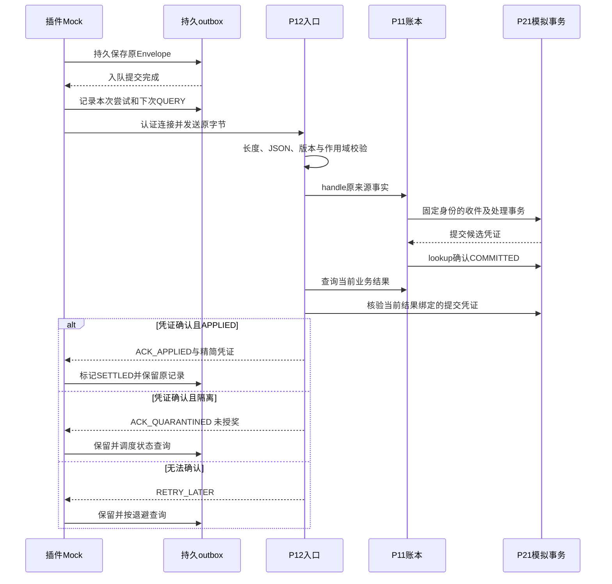

# ACK、丢失恢复与隔离跟踪时序

本图和代码均为0.1.0-isolated候选；P11使用未改动的真实交付源码，P17/P21及源事件证据使用明确标识的模拟器。

## ACK在链路中丢失

服务端已提交但回复丢失：插件outbox已在发送前记录QUERY。下一次工作以event指纹查询P11，当前权威结果为APPLIED时返回同一有效凭证；P12不再次计算奖值，也不新建业务交易。进程测试记录在 `evidence/author_run_006/process_replay/server_exit_after_commit_before_ack.json`。

客户端已收到ACK但确认outbox前退出：outbox仍为IN_FLIGHT，lease结束后查询；不会据网络历史猜测是否收到。对应测试实际使用退出码72结束客户端进程，再启动新进程核验。

提交前服务端退出：SQLite模拟事务回滚，既有持久收件仍可查。QUERY返回待处理并提示SUBMIT，客户端重投原始字节。之后钱包版本只增加一次。该证据不覆盖真实P21、断电、驱动缓存或磁盘坏块。

## 隔离和撤销

ACK_QUARANTINED不是最终消费完成。outbox状态为WATCHING_QUARANTINE，源输入和提交摘要仍留存；复核只能经P11的新增证据流程，本协议不开放远程resolve/admin接口。查询可以观察P11后来确认的APPLIED、REVERTED或REJECTED。

Undo先到时，P11持久墓碑可以返回STATUS/REVERTED。不能把这个控制事件包装成ACK_APPLIED。原完成后来到达时不授奖。存在已消费差额时，P11的PENDING_RECONCILIATION映射为RETRY_LATER并明确UNDETERMINED，不能用ACK_QUARANTINED声称完全没有经济变化。

正常已确认结果也是时点结果。未来有效Undo/Restore可能改变同一修正族；游戏当前余额必须读取P11/P17权威状态，不能在UI消费ACK时自己加减奖励。
